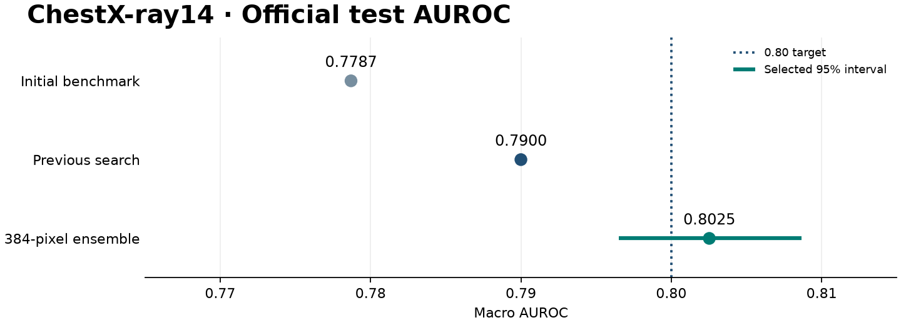

# High-resolution chest X-ray experiment



| Official test metric | Previous model | Selected ensemble |
| --- | ---: | ---: |
| Macro AUROC | 0.7900 | **0.8025** |
| Macro average precision | 0.2487 | **0.2591** |
| Macro Brier score | 0.0587 | **0.0580** |

The paired AUROC gain was **+0.0125** with a 95% interval of +0.0108 to +0.0146. The selected score has a 95% patient-bootstrap interval of 0.7965–0.8087. The point estimate exceeds 0.80 and its interval includes 0.80. The 1,000 paired resamples preserve dependence among images from the same patient.

## Model selection

| Candidate family | Best validation AUROC |
| --- | ---: |
| Previous locked ensemble | 0.8271 |
| CheXpert-initialized DenseNet-121 | 0.7659 |
| EfficientNet and DINOv2 feature fusion | 0.7853 |
| 384-pixel residual model | 0.8243 |
| Equal logit blend of the previous and 384-pixel models | **0.8352** |

The search compared 186 validation recipes across single models and logit fusion rules. The winning blend gives both components equal weight. The 384-pixel model adapts the last two residual stages with the 76,084 training radiographs and chooses an epoch using the 10,411 validation radiographs. The validation phase also fixes calibration and thresholds.

The 25,596 official test images come from 2,797 patient IDs. The grouped development split also accounts for exact duplicate images. The official benchmark has been evaluated in previous experiments. This round verifies improvement on the same split.

## Discrimination by finding

| Finding | AUROC |
| --- | ---: |
| Atelectasis | 0.7648 |
| Cardiomegaly | 0.8803 |
| Effusion | 0.8251 |
| Infiltration | 0.7108 |
| Mass | 0.7865 |
| Nodule | 0.7311 |
| Pneumonia | 0.7060 |
| Pneumothorax | 0.8586 |
| Consolidation | 0.7391 |
| Edema | 0.8502 |
| Emphysema | 0.9022 |
| Fibrosis | 0.8180 |
| Pleural thickening | 0.7672 |
| Hernia | 0.8956 |

Macro AUROC weights all 14 findings equally. Pneumonia and infiltration had the lowest discrimination against the available report-derived labels.

## Reproduce and predict

Run the [previous training workflow](README.md#reproduce-the-experiment) to generate the original cohorts and model artifacts. The [shared protocol](https://github.com/ThorsenH1/medimage-ml-lab/blob/a290fb416fe8bce87541efabb15a4a017a362d2e/docs/auroc.md) documents model selection and scoring.

```powershell
& $p -m medimage.search_features pixels chest --cohort artifacts/cache/chest --root $data --output "$experiment/pixels/chest384" --chest-size 384 --workers 8
$parent = "$search/runs/chest/adaptation-reference/best.pt"
& $p -m medimage.auc_train chest --backbone chest-reference --cohort artifacts/cache/chest --pixels "$experiment/pixels/chest384" --weights $parent --parent $parent --output "$experiment/runs/chest-reference384" --epochs 3 --batch 42 --resolution 384 --depth 2 --lr 0.00006 --head-lr 0.00013 --class-power 0.44 --seed 4413 --block 2016 --tta
```

```powershell
& $p -m medimage.auc_predict --selection "$experiment/evaluation/chest-locked-1/selection.json" --work $experiment --previous $search --original artifacts --weights $hf --image examples/phantom.png --output prediction.json
```

The [synthetic example](examples/README.md) includes the input image and the current model's complete JSON response.
