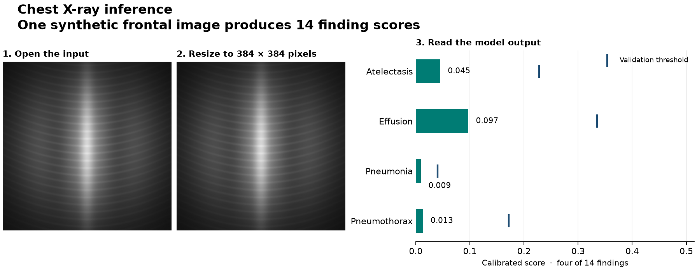
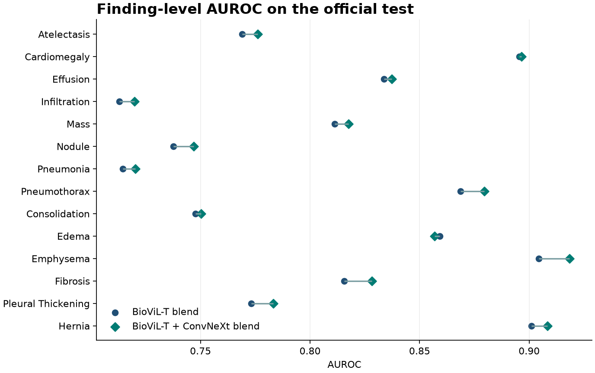
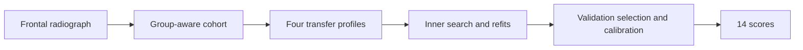

# Chest X-ray14 Multi-Label Classification

Group-aware training and calibrated prediction for 14 findings on frontal chest radiographs.

**0.8171 macro AUROC** and **0.2929 macro average precision** on 25,596 official test images. The 95% patient-bootstrap AUROC interval is 0.8107–0.8227.

The [BioViL-T and ConvNeXt report](RESEARCH.md) documents the validation ranking, paired test comparison and reproduction steps. The [earlier high-resolution experiment](AUROC.md) reached 0.8025. [Original model search](REPORT.md) · [Search trajectories](figures/search.png)

## Start with one prediction

See how a synthetic chest X-ray becomes 14 finding scores. The [walkthrough](WALKTHROUGH.md) follows the image through the three model components, explains the thresholds and shows how to check the output locally. [See which regions changed its effusion score](WHERE-THE-MODEL-LOOKS.md)



## Benchmark



The paired change in macro AUROC was +0.0068. [See the confidence intervals and earlier experiments](RESEARCH.md#official-test-result-with-convnext)

## Dataset

| Partition | Images | Patient IDs |
| --- | ---: | ---: |
| Train | 76,084 | 24,643 |
| Validation | 10,411 | 3,361 |
| Official test | 25,596 | 2,797 |

The cohort groups patient IDs linked by identical images and retains the official NIH test list. Labels are report-derived. Macro metrics give rare findings the same top-level weight as common findings. [NIH release](https://nihcc.app.box.com/v/ChestXray-NIHCC) · [Dataset paper](https://arxiv.org/abs/1705.02315)

## Workflow



The project uses a pinned [shared training engine](https://github.com/ThorsenH1/medimage-ml-lab) and has a task-specific runner. The published artifact contains source, aggregate benchmark results, and synthetic examples. Dataset files, checkpoints, and individual evaluation predictions stay in local storage.

## Reproduce the experiment

Use Python 3.11, PowerShell 7, and a CUDA-capable GPU. The original workstation used an RTX 2080 SUPER with 8 GiB VRAM.

```powershell
python -m venv .venv
$p = './.venv/Scripts/python.exe'
& $p -m pip install torch==2.14.0+cu126 torchvision==0.29.0+cu126 --index-url https://download.pytorch.org/whl/cu126
& $p -m pip install -r requirements.txt
```

Set the data and pretrained weight locations for your machine. The initial ResNet-18 weight directory uses `hub/checkpoints/resnet18-f37072fd.pth`. The Hugging Face cache uses `refs/main` and `snapshots/<revision>/model.safetensors`. Use the Hugging Face snapshots for `timm/efficientnet_b0.ra_in1k`, `timm/resnet50.a1_in1k`, and `timm/vit_small_patch14_dinov2.lvd142m`. [Initial ResNet-18 weights](https://download.pytorch.org/models/resnet18-f37072fd.pth)

```powershell
$data = 'D:/datasets/chest'
$torchCache = 'D:/models/torch'
$hf = 'D:/models/huggingface/hub'
pwsh -File scripts/Run-Project.ps1 -Task chest -Python $p -DataRoot $data -InitialWeights $torchCache -WeightRoot $hf
```

The runner writes the initial experiment under `artifacts/` and the extended search under `search-artifacts/`. For a larger volume, supply `-Artifacts` and `-Search` and use matching paths at inference. The prepared caches and training stages can resume from saved boundaries.

## Predict from raw input

Use the [ConvNeXt workflow](RESEARCH.md#reproduce-the-convnext-model-and-paired-comparison) to prepare the selected ensemble and its validation lock.

```powershell
& $p -m medimage.auc_predict --selection "$convnextEvaluation/selection.json" --work $experiment --previous $search --original artifacts --weights $hf --image 'C:/images/frontal.png' --output "$convnextEvaluation/chest-prediction.json"
```

The [example](examples/README.md) runs the selected local models on deterministic synthetic inputs. This is a research and education project.
