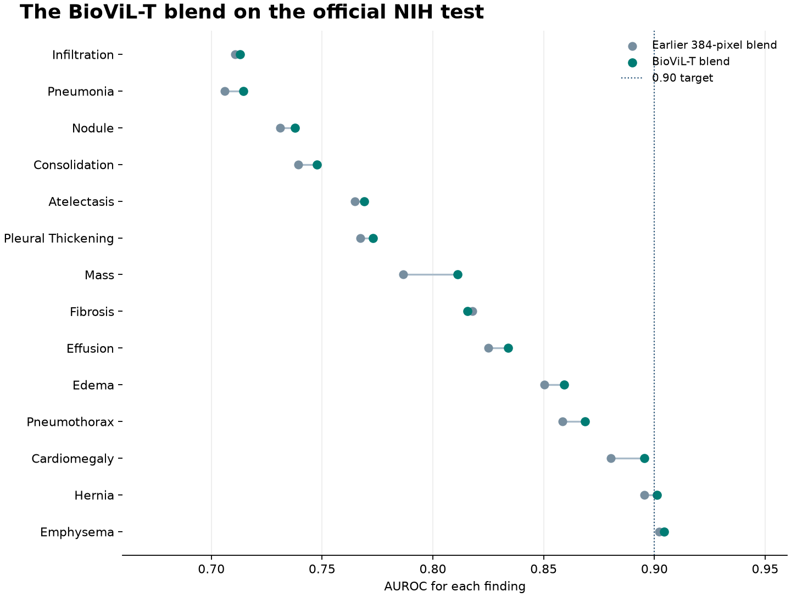

# Improving the chest X-ray model

The original high-resolution ensemble reached **0.8025 macro AUROC** across 14 findings. Pneumonia and infiltration reached **0.7060** and **0.7108**, respectively. The BioViL-T follow-up tests whether separate whole-image and local scoring heads improve the results. [Earlier benchmark](AUROC.md)

## Why the choice of pretrained model matters

Transfer learning starts a model with visual features learned elsewhere. The experiment still needs a trustworthy answer to whether the model recognizes new images. A test image can indirectly enter training through a copy attached to a different patient record.

The CheXWorld paper reports **0.8358 macro AUROC** on its NIH test configuration. I compared its released NIH lists with the prepared project cohort before using the checkpoint.

| Provenance check | Count |
| --- | ---: |
| Project official test files listed in the authors' official test | 25,596 |
| Direct test filenames found in the authors' training list | 0 |
| Official test radiographs in duplicate-linked groups that also touch the authors' training list | 72 |
| Project validation radiographs in the authors' training list | 9,392 |

The patient-linked duplicate groups were detected by the project's exact-pixel audit. The 72 count covers every radiograph in the affected groups, including images that are themselves unique. The checkpoint is excluded from the clean full-cohort comparison. [CheXWorld paper and weights](https://github.com/LeapLabTHU/CheXWorld) · [Authors' training and evaluation split](https://openaccess.thecvf.com/content/CVPR2025/supplemental/Yue_CheXWorld_Exploring_Image_CVPR_2025_supplemental.pdf)

## A model trained on lung images from a different source

The BioViL-T image backbone learned from chest X-rays in MIMIC-CXR. This project transfers its single-image ResNet-50 and fits two scoring heads on NIH training images. One summarizes the whole image. The other scores local evidence for each finding and highlights strong regions in the final ranking score. Both run on the full frontal image. [BioViL-T model card and training data](https://huggingface.co/microsoft/BiomedVLP-BioViL-T)

## The selected model and official test result

The BioViL-T branch reached **0.8398 validation AUROC** in epoch 3 of 5. Selection compared 269 recipes on the same validation split. The winner combines BioViL-T and the reference at 75% and 25%, with **0.8468 validation AUROC**. The ensemble weights and calibration were locked before test scoring.

| Metric on the same 25,596 official test images | Earlier high-resolution model | BioViL-T blend |
| --- | ---: | ---: |
| Macro AUROC | 0.8025 | **0.8103** |
| Macro average precision | 0.2591 | **0.2804** |
| Macro Brier score | 0.0580 | **0.0573** |
| Pneumonia AUROC | 0.7060 | **0.7145** |
| Infiltration AUROC | 0.7108 | **0.7129** |

The 95% patient-bootstrap AUROC interval is **0.8039–0.8161**. The paired AUROC gain is **+0.0078** with an interval of **+0.0044 to +0.0105**. The official benchmark has been reused across project rounds. A new matched cohort would provide independent confirmation.



## Reproduce the selected model

Use the candidates from the [previous training commands](AUROC.md#reproduce-and-predict). The following commands reuse their artifacts and add the BioViL-T branch. Download the image model file with SHA-256 `146c244155c930bead77165442c3f3d799b8d26fd0aed627064dd8d53c3b8624`. [Pinned Microsoft image weights](https://huggingface.co/microsoft/BiomedVLP-BioViL-T/blob/7ea37f45d77abfb21c937ce6ced5c205357743f8/biovil_t_image_model_proj_size_128.pt)

```powershell
$biovil = 'D:/weights/biovil-t.pt'
$evaluation = "$experiment/evaluation/chest-biovil-lock"
& $p -m medimage.auc_train chest --backbone biovil-t --cohort $cohort --pixels $pixels384 `
    --weights $biovil --output "$experiment/runs/chest-biovil-384" --epochs 5 --batch 24 `
    --accumulate 2 --resolution 384 --depth 1 --lr 0.00010 --head-lr 0.00035 `
    --class-power 0.35 --seed 5101 --block 1152 --tta

$paths = @('--work', $experiment, '--previous', $search, '--cohort', $cohort, '--output', $evaluation)
& $p -m medimage.auc_selection lock chest @paths `
    --candidate 'chex224=runs/chest-chex224@previous-chest224' `
    --candidate 'reference384=runs/chest-reference384@chest384' `
    --candidate 'fusion-1=runs/chest-feature-fusion/recipe-1@previous-chest224' `
    --candidate 'fusion-2=runs/chest-feature-fusion/recipe-2@previous-chest224' `
    --candidate 'fusion-3=runs/chest-feature-fusion/recipe-3@previous-chest224' `
    --candidate 'biovil384=runs/chest-biovil-384@chest384'
& $p -m medimage.auc_selection test chest @paths --weights $hf --bootstrap 1000
```

The [prediction walkthrough](WALKTHROUGH.md) reproduces one frontal-image result and links to the regional sensitivity test.

## Train a ConvNeXt model and check weighting per finding

A ConvNeXt V2 Tiny model adds a third set of image scores. It starts from ImageNet weights and learns to score all 14 findings on NIH training images. Its best checkpoint was epoch 3 of 4 with **0.8404 validation macro AUROC**. [ConvNeXt checkpoint and training recipe](https://huggingface.co/timm/convnextv2_tiny.fcmae_ft_in22k_in1k)

I compared 372 recipes on **10,411 validation X-rays in 3,361 duplicate-aware patient groups**. The selected recipe averages the raw scores from the reference, BioViL-T, and ConvNeXt models with equal weights. The next experiment let each finding have its own weights. It learned them from positive–negative pairs, with a penalty for moving away from equal weights, and evaluated them in five folds that kept each patient group together.

| Recipe on the development validation split | Macro AUROC | Macro average precision |
| --- | ---: | ---: |
| Equal blend of reference, BioViL-T, and ConvNeXt | **0.8524** | **0.2813** |
| Best cross-fitted weighting per finding | 0.8509 | 0.2776 |

The per-finding weights fell short on both metrics. The equal-weight blend proceeds to official test scoring. The completed official test result reported above is **0.8103** for the earlier BioViL-T blend.

The ConvNeXt weight file has SHA-256 `6652fd90fc9c23977659e58515778e16fbbcd43f0b01fc693089cebe6d64c2a9`. Repeat the previous selection command using `$convnextEvaluation` as its output directory and add `--candidate 'convnext224=runs/chest-convnext224@previous-chest224'` to its candidate list.

```powershell
$convnext = 'D:/weights/convnextv2-tiny.safetensors'
$convnextEvaluation = "$experiment/evaluation/chest-convnext224-lock"
& $p -m medimage.auc_train chest --backbone convnext-chest --cohort $cohort `
    --pixels "$search/pixels/chest" --weights $convnext `
    --output "$experiment/runs/chest-convnext224" --epochs 4 --batch 32 --accumulate 2 `
    --resolution 224 --depth 2 --lr 0.00016 --head-lr 0.0005 --class-power 0.29 `
    --dropout 0.28 --seed 5251 --block 2048 --tta
```

After selection, run the grouped weighting experiment with the saved model scores.

```powershell
& $p -m medimage.chest_rank_blend --base-lock "$convnextEvaluation/selection.json" `
    --work $experiment --previous $search --cohort $cohort `
    --output "$experiment/evaluation/chest-convnext224-ranking"
```
