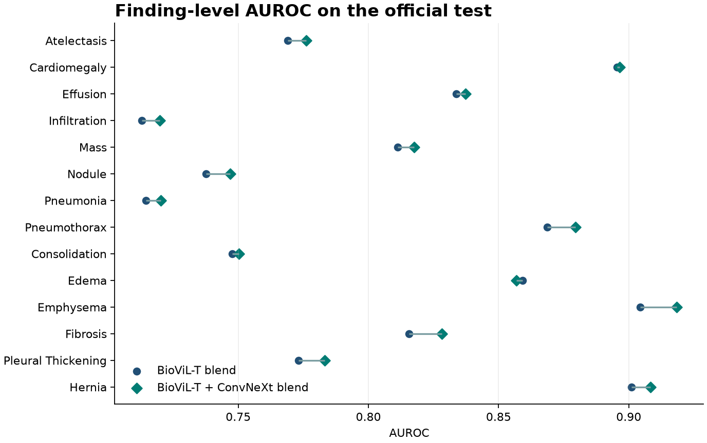
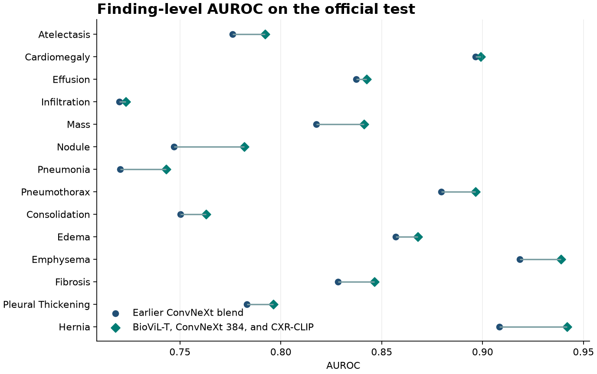

# Improving the chest X-ray model

The original high-resolution ensemble reached **0.8025 macro AUROC** across 14 findings. Pneumonia and infiltration reached **0.7060** and **0.7108**, respectively. The BioViL-T follow-up tests whether separate whole-image and local scoring heads improve the results. [Earlier benchmark](AUROC.md)

## Why the choice of pretrained model matters

Transfer learning starts a model with visual features learned elsewhere. The experiment still needs a trustworthy answer to whether the model recognizes new images. A test image can indirectly enter training through a copy attached to a different patient record.

The CheXWorld paper reports **0.8358 macro AUROC** on its NIH test configuration. I compared its released NIH lists with the prepared project cohort before using the checkpoint.

| Provenance check | Count |
| --- | ---: |
| Project official test files listed in the authors' official test | 25,596 |
| Direct test filenames found in the authors' training list | 0 |
| Official test radiographs in duplicate-linked groups that also touch the authors' training list | 72 |
| Project validation radiographs in the authors' training list | 9,392 |

The patient-linked duplicate groups were detected by the project's exact-pixel audit. The 72 count covers every radiograph in the affected groups, including images that are themselves unique. The checkpoint is excluded from the clean full-cohort comparison. [CheXWorld paper and weights](https://github.com/LeapLabTHU/CheXWorld) · [Authors' training and evaluation split](https://openaccess.thecvf.com/content/CVPR2025/supplemental/Yue_CheXWorld_Exploring_Image_CVPR_2025_supplemental.pdf)

## A model trained on lung images from a different source

The BioViL-T image backbone learned from chest X-rays in MIMIC-CXR. This project transfers its single-image ResNet-50 and fits two scoring heads on NIH training images. One summarizes the whole image. The other scores local evidence for each finding and highlights strong regions in the final ranking score. Both run on the full frontal image. [BioViL-T model card and training data](https://huggingface.co/microsoft/BiomedVLP-BioViL-T)

## The BioViL-T model and its official test result

The BioViL-T branch reached **0.8398 validation AUROC** in epoch 3 of 5. Selection compared 269 recipes on the same validation split. The winner combines BioViL-T and the reference at 75% and 25%, with **0.8468 validation AUROC**. The ensemble weights and calibration were locked before test scoring.

| Metric on the same 25,596 official test images | Earlier high-resolution model | BioViL-T blend |
| --- | ---: | ---: |
| Macro AUROC | 0.8025 | **0.8103** |
| Macro average precision | 0.2591 | **0.2804** |
| Macro Brier score | 0.0580 | **0.0573** |
| Pneumonia AUROC | 0.7060 | **0.7145** |
| Infiltration AUROC | 0.7108 | **0.7129** |

The 95% patient-bootstrap AUROC interval is **0.8039–0.8161**. The paired AUROC gain is **+0.0078** with an interval of **+0.0044 to +0.0105**. The official benchmark has been reused across project rounds. A new matched cohort would provide independent confirmation.


## Reproduce the BioViL-T model

Use the candidates from the [previous training commands](AUROC.md#reproduce-and-predict). The following commands reuse their artifacts and add the BioViL-T branch. Download the image model file with SHA-256 `146c244155c930bead77165442c3f3d799b8d26fd0aed627064dd8d53c3b8624`. [Pinned Microsoft image weights](https://huggingface.co/microsoft/BiomedVLP-BioViL-T/blob/7ea37f45d77abfb21c937ce6ced5c205357743f8/biovil_t_image_model_proj_size_128.pt)

```powershell
$biovil = 'D:/weights/biovil-t.pt'
$evaluation = "$experiment/evaluation/chest-biovil-lock"
& $p -m medimage.auc_train chest --backbone biovil-t --cohort $cohort --pixels $pixels384 `
    --weights $biovil --output "$experiment/runs/chest-biovil-384" --epochs 5 --batch 24 `
    --accumulate 2 --resolution 384 --depth 1 --lr 0.00010 --head-lr 0.00035 `
    --class-power 0.35 --seed 5101 --block 1152 --tta

$paths = @('--work', $experiment, '--previous', $search, '--cohort', $cohort, '--output', $evaluation)
& $p -m medimage.auc_selection lock chest @paths `
    --candidate 'chex224=runs/chest-chex224@previous-chest224' `
    --candidate 'reference384=runs/chest-reference384@chest384' `
    --candidate 'fusion-1=runs/chest-feature-fusion/recipe-1@previous-chest224' `
    --candidate 'fusion-2=runs/chest-feature-fusion/recipe-2@previous-chest224' `
    --candidate 'fusion-3=runs/chest-feature-fusion/recipe-3@previous-chest224' `
    --candidate 'biovil384=runs/chest-biovil-384@chest384'
& $p -m medimage.auc_selection test chest @paths --weights $hf --bootstrap 1000
```

The [prediction walkthrough](WALKTHROUGH.md) reproduces one frontal-image result and links to the regional sensitivity test.

## Train a ConvNeXt model and check weighting per finding

A ConvNeXt V2 Tiny model adds a third set of image scores. It starts from ImageNet weights and learns to score all 14 findings on NIH training images. Its best checkpoint was epoch 3 of 4 with **0.8404 validation macro AUROC**. [ConvNeXt checkpoint and training recipe](https://huggingface.co/timm/convnextv2_tiny.fcmae_ft_in22k_in1k)

I compared 372 recipes on **10,411 validation X-rays in 3,361 duplicate-aware patient groups**. The selected recipe averages the raw scores from the reference, BioViL-T, and ConvNeXt models with equal weights. The next experiment let each finding have its own weights. It learned them from positive–negative pairs, with a penalty for moving away from equal weights, and evaluated them in five folds that kept each patient group together.

| Recipe on the development validation split | Macro AUROC | Macro average precision |
| --- | ---: | ---: |
| Equal blend of reference, BioViL-T, and ConvNeXt | **0.8524** | **0.2813** |
| Best cross-fitted weighting per finding | 0.8509 | 0.2776 |

The per-finding weights fell short on both metrics. I froze the equal-weight blend and its calibration before scoring the official test.

## Official test result with ConvNeXt

| Metric on the same 25,596 test images | BioViL-T blend | BioViL-T + ConvNeXt blend |
| --- | ---: | ---: |
| Macro AUROC | 0.8103 | **0.8171** |
| Macro average precision | 0.2804 | **0.2929** |
| Macro Brier score, lower is better | 0.0573 | **0.0567** |
| Pneumonia AUROC | 0.7145 | **0.7203** |
| Infiltration AUROC | 0.7129 | **0.7199** |
| Emphysema AUROC | 0.9043 | **0.9185** |
| Edema AUROC | **0.8593** | 0.8568 |

The patient-bootstrap 95% AUROC interval is **0.8107–0.8227**. Paired resampling of **2,797 patient groups** gives an AUROC gain of **+0.0068**, with a 95% interval of **+0.0054 to +0.0083**. Average precision increased by **+0.0125**, with a 95% interval of **+0.0082 to +0.0165**.

AUROC improved for 13 of the 14 findings. Pneumonia and infiltration are still the two lowest-scoring findings. The project has tested multiple fixed recipes against the same official images. An independent cohort is needed to measure transfer across sites.



## Reproduce the ConvNeXt model and paired comparison

The ConvNeXt weight file has SHA-256 `6652fd90fc9c23977659e58515778e16fbbcd43f0b01fc693089cebe6d64c2a9`. Prepare the previous candidates with the [BioViL-T commands](#reproduce-the-biovil-t-model) before adding the 224-pixel model.

```powershell
$convnext = 'D:/weights/convnextv2-tiny.safetensors'
$convnextEvaluation = "$experiment/evaluation/chest-convnext224-lock"
& $p -m medimage.auc_train chest --backbone convnext-chest --cohort $cohort `
    --pixels "$search/pixels/chest" --weights $convnext `
    --output "$experiment/runs/chest-convnext224" --epochs 4 --batch 32 --accumulate 2 `
    --resolution 224 --depth 2 --lr 0.00016 --head-lr 0.0005 --class-power 0.29 `
    --dropout 0.28 --seed 5251 --block 2048 --tta

$convnextPaths = @('--work', $experiment, '--previous', $search, '--cohort', $cohort, '--output', $convnextEvaluation)
& $p -m medimage.auc_selection lock chest @convnextPaths `
    --candidate 'chex224=runs/chest-chex224@previous-chest224' `
    --candidate 'reference384=runs/chest-reference384@chest384' `
    --candidate 'fusion-1=runs/chest-feature-fusion/recipe-1@previous-chest224' `
    --candidate 'fusion-2=runs/chest-feature-fusion/recipe-2@previous-chest224' `
    --candidate 'fusion-3=runs/chest-feature-fusion/recipe-3@previous-chest224' `
    --candidate 'biovil384=runs/chest-biovil-384@chest384' `
    --candidate 'convnext224=runs/chest-convnext224@previous-chest224'
& $p -m medimage.auc_selection test chest @convnextPaths --weights $hf --bootstrap 1000
& $p -m medimage.auc_compare --cohort $cohort --reference $evaluation --candidate $convnextEvaluation `
    --output "$convnextEvaluation/paired-biovil.json" --figure "$convnextEvaluation/convnext-comparison.png" `
    --reference-name 'BioViL-T blend' --candidate-name 'BioViL-T + ConvNeXt blend'
```

After selection, run the grouped weighting experiment with the saved model scores.

```powershell
& $p -m medimage.chest_rank_blend --base-lock "$convnextEvaluation/selection.json" `
    --work $experiment --previous $search --cohort $cohort `
    --output "$experiment/evaluation/chest-convnext224-ranking"
```

## Test another chest-specific image encoder

CXR-CLIP provides separate checkpoints by architecture and pretraining data. This trial uses the Swin Tiny weights trained on **MIMIC-CXR plus CheXpert**. The authors list ChestX-ray14 in a separate release. This lets the project test another chest-trained representation under the existing NIH cohort split. I verified the image-weight conversion, the 14-output classifier and gradients in the unfrozen stages on a synthetic frontal input. [Paper](https://arxiv.org/abs/2310.13292) · [Authors' checkpoint table](https://github.com/Soombit-ai/cxr-clip#pre-trained-model-checkpoint)

Use the file with SHA-256 `19ad633804daa3fd6d48d26a93d3731356eed8dfc836102b95d1c5965c144608`. The model reads 224-pixel grayscale images repeated across three channels. The classifier learns from the global average and maximum of the Swin feature grid. Fine-tune the last two stages on the same training data and evaluate each epoch on validation.

```powershell
$cxrClip = 'D:/weights/swint_mc.tar'
& $p -m medimage.auc_train chest --backbone cxr-clip-swin --cohort $cohort `
    --pixels "$search/pixels/chest" --weights $cxrClip `
    --output "$experiment/runs/chest-cxr-clip-swin224" --epochs 4 --batch 10 --accumulate 6 `
    --resolution 224 --depth 2 --lr 0.00009 --head-lr 0.00042 --class-power 0.29 `
    --dropout 0.28 --seed 5751 --block 2048 --tta
```

Add `cxrswin224=runs/chest-cxr-clip-swin224@previous-chest224` to the ConvNeXt candidate list and write to a fresh evaluation directory. To reuse the exact ConvNeXt and BioViL-T component scores, pass `--reuse-components $convnextEvaluation` when scoring the new lock. The engine checks the cohort, label order, full component configuration and cache provenance. A replay reproduced all 25,596 test predictions exactly.

The individual CXR-CLIP branch peaked in epoch **3 of 4** at **0.8478 validation AUROC**. The search picked an equal blend of BioViL-T, ConvNeXt 224, and CXR-CLIP at **0.8576 validation AUROC**. It reached **0.8286** on the official test.

## Combine CXR-CLIP with higher-resolution ConvNeXt

The ConvNeXt follow-up starts from its 224-pixel checkpoint and adapts it to images at **384 × 384**. Its best of three epochs had **0.8568 validation AUROC**. The initial resolution search favored 75% ConvNeXt 384 and 25% BioViL-T, for **0.8618 validation AUROC**. When both new candidates competed in the same search, the best of 646 recipes gave equal weight to **BioViL-T, ConvNeXt 384 and CXR-CLIP**, with **0.8650 validation AUROC**.

| Frozen trial | Validation AUROC | Official test AUROC | Official test average precision |
| --- | ---: | ---: | ---: |
| BioViL-T, ConvNeXt 224 and the earlier reference | 0.8524 | 0.8171 | 0.2929 |
| BioViL-T, ConvNeXt 224 and CXR-CLIP | 0.8576 | 0.8286 | 0.3076 |
| BioViL-T and ConvNeXt 384 | 0.8618 | 0.8284 | 0.3087 |
| BioViL-T, ConvNeXt 384 and CXR-CLIP | **0.8650** | **0.8339** | **0.3138** |

The selected model reached **0.8339** across the 14 findings on the same 25,596 test images. Its 95% patient-bootstrap AUROC interval was **0.8280–0.8390**. The paired improvement over the earlier 0.8171 ensemble was **+0.0168** with a 95% interval of **+0.0144 to +0.0194**. AUROC improved for all 14 findings in that comparison. The paired gain over the 224-pixel CXR-CLIP blend was **+0.0053**, with a 95% interval of **+0.0043 to +0.0061**. Pneumonia rose to **0.7432**, and infiltration rose to **0.7231** relative to the 0.8171 model. The official test is the same NIH cohort used in earlier rounds.



### Reproduce the selected three-model ensemble

Prepare the 224-pixel ConvNeXt and CXR-CLIP runs above. Warm-start the 384-pixel follow-up from the best 224-pixel checkpoint.

```powershell
& $p -m medimage.auc_train chest --backbone convnext-chest --cohort $cohort --pixels $pixels384 `
    --weights $convnext --parent "$experiment/runs/chest-convnext224/best.pt" `
    --output "$experiment/runs/chest-convnext384" --epochs 3 --batch 10 --accumulate 6 `
    --resolution 384 --depth 2 --lr 0.000075 --head-lr 0.00022 --class-power 0.29 `
    --dropout 0.28 --seed 5253 --block 1024 --tta

$jointEvaluation = "$experiment/evaluation/chest-swin-convnext384-lock"
$jointPaths = @('--work', $experiment, '--previous', $search, '--cohort', $cohort, '--output', $jointEvaluation)
& $p -m medimage.auc_selection lock chest @jointPaths `
    --candidate 'chex224=runs/chest-chex224@previous-chest224' `
    --candidate 'reference384=runs/chest-reference384@chest384' `
    --candidate 'fusion-1=runs/chest-feature-fusion/recipe-1@previous-chest224' `
    --candidate 'fusion-2=runs/chest-feature-fusion/recipe-2@previous-chest224' `
    --candidate 'fusion-3=runs/chest-feature-fusion/recipe-3@previous-chest224' `
    --candidate 'biovil384=runs/chest-biovil-384@chest384' `
    --candidate 'convnext224=runs/chest-convnext224@previous-chest224' `
    --candidate 'convnext384=runs/chest-convnext384@chest384' `
    --candidate 'cxrswin224=runs/chest-cxr-clip-swin224@previous-chest224'
& $p -m medimage.auc_selection test chest @jointPaths --weights $hf --bootstrap 1000
& $p -m medimage.auc_compare --cohort $cohort --reference $convnextEvaluation --candidate $jointEvaluation `
    --output "$jointEvaluation/paired-previous.json" --figure "$jointEvaluation/finding-comparison.png" `
    --reference-name 'Earlier ConvNeXt blend' --candidate-name 'BioViL-T, ConvNeXt 384, and CXR-CLIP'
```

The [prediction walkthrough](WALKTHROUGH.md) follows the selected model from an example image to the 14 calibrated outputs.

## Give easy negatives less weight during training

The follow-up starts from the 384-pixel ConvNeXt checkpoint and fine-tunes for two epochs. For negative labels, the loss weight is the model's predicted probability raised to 0.75. A negative example that the model already scores near zero contributes less. Positive examples use class weighting with exponent 0.20. The experiment competes against the current blend on the same patient-grouped validation split.

```powershell
& $p -m medimage.auc_train chest --backbone convnext-chest --cohort $cohort --pixels $pixels384 `
    --weights $convnext --parent "$experiment/runs/chest-convnext384/best.pt" `
    --output "$experiment/runs/chest-convnext384-focal" --epochs 2 --batch 16 --accumulate 4 `
    --resolution 384 --depth 2 --lr 0.000045 --head-lr 0.00016 --class-power 0.20 `
    --focal-neg 0.75 --dropout 0.28 --seed 5767 --block 1024 --tta
```

Add `convnext384-focal=runs/chest-convnext384-focal@chest384` to the same candidate list and save a separate validation decision. The follow-up qualifies for official test scoring when a blend uses this branch and improves on **0.8650 validation AUROC**.

## Check whether projection information improves ranking

An AP or PA projection label records the direction in which the image was taken. I tested whether a separate correction for each projection helps the model rank patients. Each of five validation folds fits global calibration, then learns a small per-finding offset for AP and PA from the other four folds. The same patient group stays together. The offsets shrink toward zero for findings with little evidence for a correction.

| Scoring rule on 10,411 validation images | Macro AUROC | Macro average precision |
| --- | ---: | ---: |
| Frozen three-model raw score | **0.8650** | **0.2953** |
| Cross-fitted global calibration | 0.8630 | 0.2911 |
| Cross-fitted global calibration and view offsets | 0.8630 | 0.2920 |

Adding the offsets changed AUROC by **−0.00003** relative to the same cross-fitted global calibration. The mean Brier score moved from 0.033828 to 0.033813. The larger difference relative to the frozen raw score includes the effect of fitting separate calibration parameters across folds. The reference for this experiment uses the frozen raw-score blend and one global calibration per finding.

```powershell
& $p -m medimage.chest_view_audit --base-lock "$jointEvaluation/selection.json" --cohort $cohort `
    --work $experiment --previous $search --output "$jointEvaluation/view-validation.json" --bootstrap 1000
```

## Fit a different blend for each finding

The three models can rank one finding differently from another. For each of the 14 findings, I sampled pairs with one positive and one negative labeled image. The fit rewards weights that place the positive image above the negative image. The three weights are nonnegative and sum to one. A penalty pulls them toward equal weights, especially when positive examples are scarce.

I compared penalties of 0.03, 0.18, and 0.70 on both the original and calibrated component scores. Each of five folds learns its weights from the other four validation folds. Patient groups stay together. The winner used the original component scores with penalty 0.03. I refit those weights and the final probability calibration on all 10,411 validation images before evaluating the test set.

| Combination rule | Validation macro AUROC | Test macro AUROC | Test average precision | Test Brier score ↓ |
| --- | ---: | ---: | ---: | ---: |
| Equal weights | 0.86496 | 0.83387 | 0.31378 | 0.05563 |
| Best per-finding weights after component calibration | 0.86408 | — | — | — |
| Per-finding weights on original logits | **0.86634** | **0.83502** | **0.31540** | **0.05548** |

The paired AUROC gain was **0.00115**, with a 95% patient-bootstrap interval of **+0.00075 to +0.00151**. The test AUROC interval for the selected recipe was **0.82908–0.84007**. Ten findings improved, including nodule by **0.00445**. Pneumonia fell by **0.00172**. The 25,596-image official test uses the same NIH cohort as earlier rounds. [Paired aggregate results by finding](figures/ranking-comparison.json)

```powershell
$rankEvaluation = "$experiment/evaluation/chest-finding-weights"
& $p -m medimage.chest_rank_blend --base-lock "$jointEvaluation/selection.json" `
    --work $experiment --previous $search --cohort $cohort --score-space raw --output $rankEvaluation
& $p -m medimage.chest_rank_blend --base-lock "$jointEvaluation/selection.json" `
    --work $experiment --previous $search --cohort $cohort --score-space calibrated `
    --output "$experiment/evaluation/chest-finding-weights-component-calibrated"
& $p -m medimage.auc_selection test chest --work $experiment --previous $search --cohort $cohort `
    --weights $hf --output $rankEvaluation --reuse-components $jointEvaluation --bootstrap 1000
& $p -m medimage.auc_compare --cohort $cohort --reference $jointEvaluation --candidate $rankEvaluation `
    --output "$rankEvaluation/paired-equal-weight.json" --figure "$rankEvaluation/finding-comparison.png" `
    --reference-name 'Equal weight per model' --candidate-name 'Weights fitted per finding' --bootstrap 1000
```

The test command verifies that the saved component scores came from the same checkpoints, images and labels. [Follow one prediction with the learned weights](WALKTHROUGH.md)
