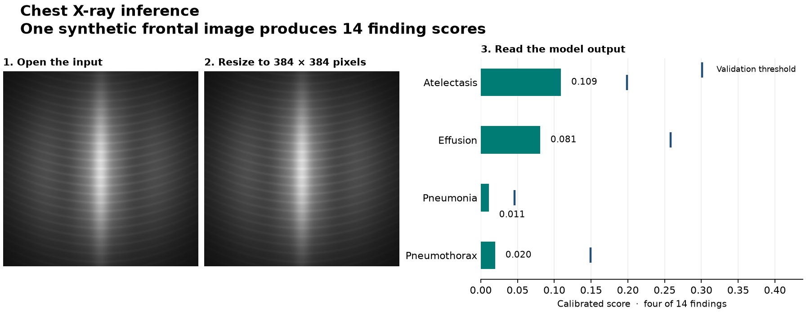

# Follow one chest X-ray prediction

A single frontal image goes through two scoring pipelines. The final model reports a score for each of 14 findings. The image below is a generated pattern and the scores came from the same model used for the reported benchmark.



## 1. Open the input

[The example image](examples/phantom.png) is a grayscale PNG. The experiment uses frontal radiographs. The model can report multiple findings for the same image, so it produces 14 separate scores.

## 2. Prepare and score the image

The high-resolution branch resizes the image to 384 × 384 pixels. It runs through a residual network, whose later layers were fine-tuned on training radiographs. The previously trained branch uses its own pixel sizes and model settings. The ensemble takes the mean of the two raw scores, or **logits**, separately for each finding. Validation fits the conversion from logits to calibrated scores.

For effusion, the mean logit is **−2.4557**, the calibrated score is **0.0807** and the validation threshold is **0.2581**. The JSON therefore gives `threshold_crossed: false` for this finding on the synthetic input. [All 14 scores](examples/auroc-ensemble.json) · [Component and calibration trace](examples/frontal-trace.json)

## 3. Run and check the example

Use `$p`, `$experiment`, `$search`, `$hf` and `$evaluation` from the [training workflow](AUROC.md#reproduce-and-predict). Run the commands below from the repository root.

```powershell
& $p -m medimage.auc_predict --selection "$evaluation/selection.json" --work $experiment `
    --previous $search --original artifacts --weights $hf --image examples/phantom.png `
    --output "$evaluation/phantom.json" --trace "$evaluation/phantom-trace.json"
& $p -m medimage.workflow_figure chest --examples examples `
    --trace "$evaluation/phantom-trace.json" --output "$evaluation/phantom-workflow.png"
```

Open the output and compare two findings. Each has its own threshold. Check that there are exactly 14 entries and that every calibrated score lies between 0 and 1. Freshly trained weights can produce different values.

## 4. Understand the test result

| What can go wrong | How the experiment addresses it |
| --- | --- |
| The same patient or image appears in both partitions | Group patients and connect groups linked by identical image pixels |
| Frequent findings dominate one overall score | Give each of the 14 findings equal weight in macro AUROC |
| A high validation score leads to a poor test choice | Freeze the selected ensemble and thresholds before scoring the official test |
| A rare finding can have high AUROC with many false positives | Report average precision and per-finding results as well |

The locked ensemble reached **0.8025 macro AUROC** and **0.2591 macro average precision** across 25,596 official test radiographs. AUROC describes ranking. Average precision reflects the tradeoff between finding positive examples and keeping predicted positives reliable. The model ranked emphysema better than pneumonia, and the labels were derived from radiology reports. [Full benchmark report](AUROC.md)
