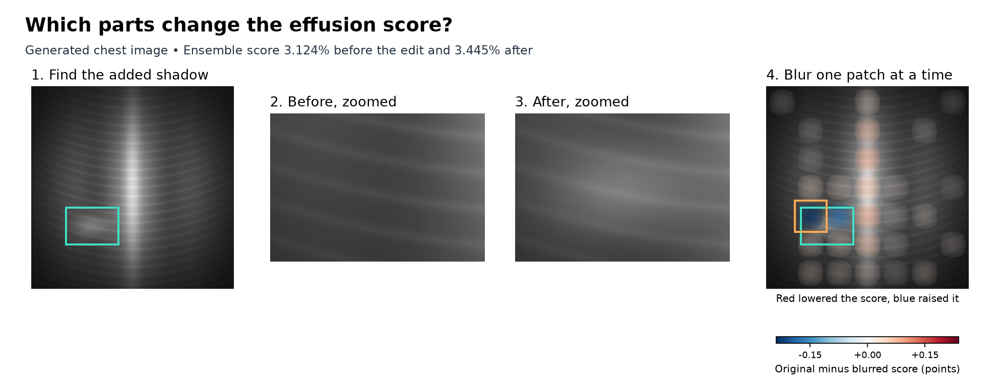

# See which parts of the image change the score



1. Find the turquoise box. It shows where a faint bright patch was added to this generated chest image.
2. Compare the two close-ups. They show the same area before and after the edit.
3. Read the heatmap. Each probe starts from the edited image and blurs just one patch. The image goes through all three models, BioViL-T, ConvNeXt and CXR-CLIP, and the usual ensemble scoring steps. The orange outline shows the patch that changed the score most.

**Red** means blurring lowered the effusion score. **Blue** means blurring raised it. The added shadow moved the score from **3.124% to 3.445%**. Blurring the orange patch, which overlaps part of the shadow, raised the score to **3.683%**. This was the largest change among the 49 patches tested. The heatmap measures how one image's score responds to blur. [Edited synthetic input](examples/phantom-edited.png) · [All measured probes](examples/ensemble-region-evidence.json)

Effusion means fluid around a lung. The generated shadow is a visual teaching device. The [prediction walkthrough](WALKTHROUGH.md) shows how the model scores the unedited image.

## Check the model's strongest location against reference boxes

The NIH box file contains 984 annotations for eight findings across 880 images in the official test split. For each annotated finding, I took the strongest point in the BioViL-T branch's spatial score map and checked whether it fell inside a reference box for that finding.

| Rule for choosing a location | Inside a reference box |
| --- | ---: |
| BioViL-T spatial score maximum | **4.2%** |
| Uniformly chosen grid point, expected rate | 7.6% |
| Grid point closest to the image center | 21.5% |

The patient-bootstrap interval for the BioViL-T peak was **2.9–5.4%**. Results differ by finding. The peak was inside the marked area on **12.4%** of effusion examples and **10.2%** of pneumothorax examples.

This test checks the location of one internal BioViL-T score maximum on annotated positive images. It evaluates a different method from the ensemble blur experiment. Use the dataset box as the placement reference when comparing a local image with its heatmap.

Reproduce the peak audit with the locked BioViL-T model from [the research report](RESEARCH.md). Use the original NIH image folder and its box file.

```powershell
& $p -m medimage.chest_region_audit --root $data --cohort $cohort --boxes "$data/BBox_List_2017.csv" `
    --selection "$evaluation/selection.json" --work $experiment --previous $search --weights $hf `
    --output "$evaluation/localization-audit.json"
```

## Reproduce the ensemble heatmap

Use the three trained runs and the [selection with per-finding weights](RESEARCH.md#fit-a-different-blend-for-each-finding). Omitting an input file regenerates the same phantom. To study a local frontal image, add `--image` with its path and keep the resulting figure with your local data. If you have a dataset annotation, give its four original pixel coordinates with `--reference-box LEFT TOP RIGHT BOTTOM`. Repeat the option for multiple boxes. The figure shows separate close-ups of the first reference box and the patch with the largest change in score.

```powershell
& $p -m medimage.chest_ensemble_explain --selection "$rankEvaluation/selection.json" --work $experiment `
    --weights $hf --label Effusion --output "$rankEvaluation/region-probe"
```
