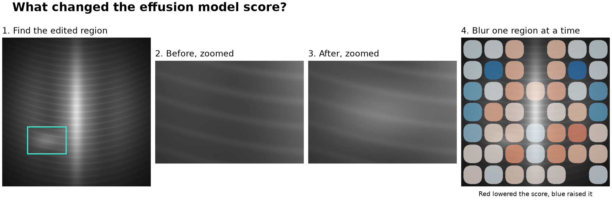

# See which parts of the image change the score



1. The turquoise box shows where a faint bright patch was added to the generated chest image.
2. The two zooms show the same patch of the image before and after the edit.
3. The last panel tests the trained **BioViL-T effusion scorer**. Each probe blurs one small region of the processed image, runs the model again and records how the score moves.

**Red** shows a region where blurring lowered the score. **Blue** shows a region where blurring raised it. The edit changed the branch's internal score from **−1.150 to −1.128**. Several regions outside the added patch mattered to the model in this example. The map is a test of the score's response to blur in this specific image. [Edited synthetic input](examples/phantom-edited.png) · [All measured probes](examples/region-evidence.json)

The example measures an internal score from one component. The [prediction walkthrough](WALKTHROUGH.md) shows how the ensemble combines that component with the reference and calibrates the final output. The generated shadow is a visual teaching device.

## Reproduce the test

Use the trained BioViL-T run and the [frozen ensemble selection](RESEARCH.md). Omitting an input file regenerates the same phantom. To study a local frontal image, add `--image` with its path and keep the resulting figure alongside your local data.

```powershell
& $p -m medimage.visual_explain --selection "$evaluation/selection.json" --work $experiment `
    --weights $hf --component biovil384 --label Effusion --output "$evaluation/region-probe"
```
